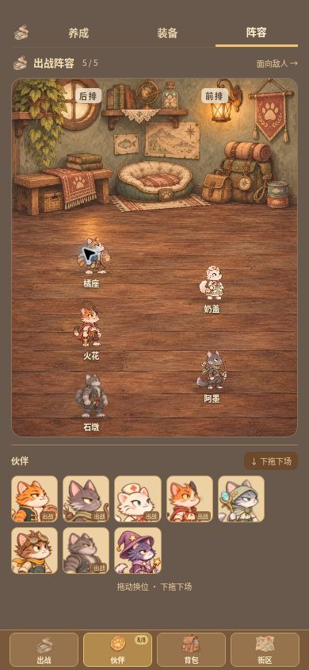

# v0.26.20 检查记录

## 实现

- 新阵容背景：`assets/scenes/formation-room-v02620.webp`，640×800，129,942 字节；与面板的 4:5 比例一致。
- 美术以现有橘座立绘为笔触参考生成，房间陈设集中在上部，五个站位落在下方地板；属于本轮新候选，不能视为用户已认可。
- `companion-display.mjs` 统一角色尺寸；石墩保留战场原有的 1.22 倍体型。统一画布 overscan 为原战场的 144%×138%。
- 全身角色继续使用当前完整角色图集；头像用单独的头部裁切，不与身体尺寸混用。
- 改写套装与特殊装备的物件故事。

## 已执行

1. `node scripts/build-web.mjs --code-only` 成功。
2. `node --test tests/*.test.mjs`：188 通过，0 失败。
3. 云端 Chromium 中运行专用、隔离存档的页面检查：320×568、430×932、390×844 均通过。每个视口遍历全部 8 位角色，验证养成/装备 CSS 尺寸与战场计算一致、两处画布分辨率一致、非透明像素存在且随待机时间变化；阵容中的 5 位也保持尺寸并持续待机。等待实际像素变化，避免远程浏览器帧调度使固定间隔采样失真。
4. 每个视口的 35 件装备可滚动到列表底部，页面无横向溢出。
5. 浏览器原生拖动：橘座与奶盖交换站位成功；从头像格拖入薄荷成功替换奶盖。实际 DOM 状态与提示均已核对。
6. 肉眼核对 390×844 阵容页面：室内背景加载、五个站位均在地板上、头像格内容可见。截图见下。

完整视口数据：[browser-report.json](browser-report.json)。

## 范围与限制

- 自动检查在浏览器中执行，不是 iPhone Safari 或微信真机测试。
- 本地 `scripts/review-companion-display.mjs` 的 Chromium 进程被运行环境限制启动；没有宣称该脚本本地通过。等价的尺寸、像素变化与滚动检查已在上述浏览器页面执行，拖动通过实际浏览器输入验证。
- 不涉及战斗数值、角色技能或存档结构调整。仍是原有本机存档网页试玩。

## 发布核对

生产提交 `9be09a0af74139aab17d9356e99542706aa58800` 的 GitHub Pages 构建 43608459672 成功。实际打开 `https://heitamu.github.io/can-club-play/?v=0.26.20`，页面显示 0.26.20，并进入「伙伴 → 阵容」核对房间已加载。生产页面截图：[live-room.jpg](live-room.jpg)。
