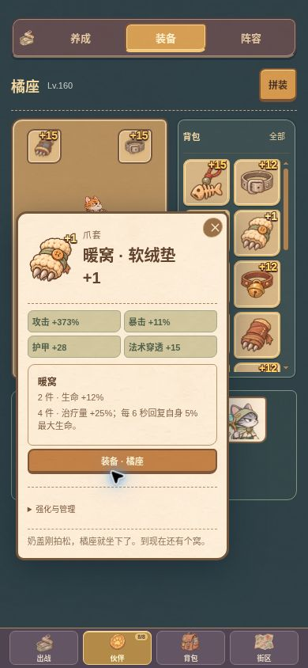

# v0.26.66 检查记录

## 实现

- 装备最高 +15，普通装备从 +1 起在背包、已穿戴栏位和详情图标的右上角显示同一套金色深棕描边数字；妙招牌不显示强化。补足装备侧栏滚动条空间，避免第二列角标被裁切。
- 攻击/生命的六阶装备系数为 1、2、4、8、16、32；主属性强化系数为 `(100 + 40n + 8n²) / 100`。防御、穿透、暴击保持独立受限曲线；等级上限 160、五星与技能突破上限不变。
- 旧 +12 存档保留装备 ID、归属、词条及成长，可继续到 +15。+15 保存、加载和导入不回退。每三次强化提升一条已有副词条，最多五次。
- 伤害以目标开场站位为固定起点，不跟随冲刺和受击偏移；同目标快速连续命中将旧数字向上错开。普通与暴击均为 10 px。暴击继续使用 v0.26.58 的两张原图，九宫格伸展中部，兼容短数字与七位数。
- 普通关前 100 关敌人预算不变；后续按固定关卡进度调整。最高难度机制关有固定倍率，不根据玩家装备动态提高。高阶打捞增加修补零件产出，早期与每日次数不变。
- 未重新绘制或修改任何角色、场景、装备、头像、特效图片。新增界面仅为现有图标角标与现有暴击框的伸展规则。新词条养成方案未定，不替换原有洗炼机制。

## 验证

- `node --test tests/*.test.mjs wechat/tests/*.test.mjs`：267 通过，0 失败。包含旧档兼容、强化消耗/上限、成长与实战伤害、战斗文本、网页流程和原生触控/存档检查。
- 修正原有技能描述测试的过时断言：伤害类说明按 v0.26.65 已实现的攻击百分比验证，不再要求显示即时伤害估值。未改变该版本的技能说明行为。
- `node scripts/build-web.mjs --code-only`：63 个模块合并为一个脚本，15 个样式合并为一个样式；原移动端角色资源共 1,915,168 字节，未重新压缩。明细见 `build.json`。
- `node scripts/build-wechat.mjs`：AppID `wx43da24c6ac1e5a12`，版本 0.26.66，主包 249,044 字节，总包 20,910,558 字节，六个分包。
- 浏览器使用真实 app 和临时满培养 fixture，屏蔽 fixture 的存档读取/保存；320、390、430 像素宽度检查装备页。列表没有横向溢出，第二列 +12 完整可见；详情弹窗 +0 强化到 +1 后角标与属性立即更新，+15 按钮禁用。
- 短数字、五位数、七位数的普通/物理暴击/法术暴击排版检查使用同一实际渲染模块；字级一致，原图边缘保留。

装备详情实际界面（测试存档）：

## 数值证据

`node scripts/audit-equipment-growth.mjs` 可重现 `balance.json`。条件为 160 级、五星、技能 rank 3、六阶珍藏 +15、按角色配套装、固定词条与站位。它是可重复的战斗模拟，不是玩家实际胜率。

- 第 600 关固定种子 527：石墩第 6 秒首次百万级技能命中 3,577,565；同场最高 9,719,797 出现在第 94 秒，包含原有久战增伤，因此不用于表示开场常态伤害。
- 600 关三组五种种子对照：130 级普通阵容 0/5；160 级同阵容 5/5；140 级护盾/破甲/灼烧配合阵容 5/5。
- 最高难度六类机制关，各检查 56 种五人阵容 × 5 个种子：冷库封锁 32/280、补给线争夺 15/280、铁壳拦路 28/280、同频警报 50/280、断电追兵 10/280、钟楼围困 23/280。每类均有至少两套五个种子全胜的阵容，仍保留搭配差异。
- 六阶单件从 +0 到 +15 合计 344,266 鱼币、2,880 修补零件。八阶打捞每次 384 零件，每日可获奖四次。

## 限制

本轮检查包括桌面浏览器中的手机宽度布局与原生自动化测试，未进行 iPhone Safari 或微信开发者工具/微信真机验收。数值模拟只覆盖所列条件，后续仍需根据真实成长速度与装备组合调整。现有本机存档、联网及正式上架状态未在本轮扩展。
