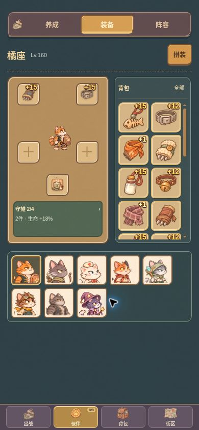

# v0.26.67 套装区域检查

- 左侧仅显示穿戴数量满足条件的套装和效果：0/1 件无显示，2/3 件显示两件套，4 件显示两档；2+2 分别显示各自两件套。
- 装备详情保留完整套装说明；未调整套装数值、装备习惯、洗炼及美术素材。
- 13 项现有装备/界面回归检查通过，另逐项检查上述六种配装状态。
- 浏览器使用不读取或保存真实进度的 fixture，逐件卸下装备验证 4→3→2→1 的即时显示与隐藏。
- Web 重新构建通过。微信原生界面不使用此左侧区域，本轮未改动原生代码。手机真机未验证。

