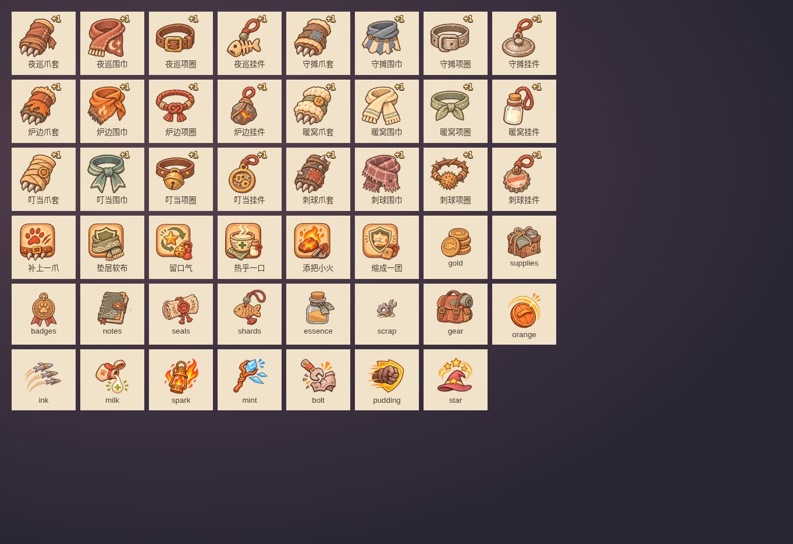

# 图标叠图修正

修复弹窗中 centred-item 仍绘制旧背景图的问题；将统一背景清除规则扩展至弹窗。修复修补零件的专用图片被通用图集高优先级规则覆盖的问题。

检查 24 个装备、6 个妙招牌、9 个材料/奖励和8个技能图标，原图保持不变。21 项相关测试通过；浏览器检查页核验 30 个装备/牌图标无背景叠图，零件实际使用专用图片和 contain 尺寸。未进行 iPhone 真机验收。

